# 学生毕业管理系统y65fk--论文

> 🎓 **计算机毕业设计 · 学生毕业管理系统y65fk--论文**
>
> 本仓库只放**项目介绍 + 运行截图**（截图是站点带水印的原图，存在仓库 `images/` 里）。
>
> 👉 **完整可运行源码 / 数据库脚本 / 部署文档：[点我获取](https://geekcode.top/archives/%E5%AD%A6%E7%94%9F%E6%AF%95%E4%B8%9A%E7%AE%A1%E7%90%86%E7%B3%BB%E7%BB%9Fy65fk-%E8%AE%BA%E6%96%87?utm_source=github)**
>
> 💬 咨询微信：**ir9372**　|　🌐 更多项目：[极客代码 geekcode.top](https://geekcode.top/?utm_source=github)
>
> 📌 项目详情页：<https://geekcode.top/archives/%E5%AD%A6%E7%94%9F%E6%AF%95%E4%B8%9A%E7%AE%A1%E7%90%86%E7%B3%BB%E7%BB%9Fy65fk-%E8%AE%BA%E6%96%87?utm_source=github>

<table><td width="230" align="center"> <b>扫码加微信 ir9372</b></td><td valign="middle">📦 源码 = 项目介绍 + 全部运行截图 + 数据库 + 部署文档 👉 点上方任意截图，直接跳到 <b>极客代码 geekcode.top</b> 详情页</td></table>

---

<h1>学生毕业管理系统_y65fk--论文</h1>
<h2>项目概述</h2>

本项目名为“学生毕业管理系统”，旨在解决高校毕业设计全流程管理中的信息分散、流程不透明及沟通效率低等问题。系统采用前后端分离架构，基于 Java Spring Boot 后端与 Vue 前端技术栈构建，并配套微信小程序作为移动端入口。核心功能涵盖学生推优、师生双选、开题答辩、过程文档管理、毕业论文提交及答辩评审等关键环节。适用人群包括高校教务管理人员、指导教师、毕业生及院校管理员。通过数字化手段实现从选题到答辩的全生命周期闭环管理，提升教学管理效率与服务质量。

<h2>技术架构</h2>

<strong>1. 总体架构设计</strong>
系统采用经典的分层架构模式，分为表现层、业务逻辑层、数据访问层和持久化层。

<ul>
<li><strong>后端服务</strong>：基于 Spring Boot 框架，利用 <code>spring-web</code>、<code>spring-mvc</code> 处理 HTTP 请求，使用 <code>MyBatis-Plus</code> 作为 ORM 框架简化数据库操作，集成 <code>Druid</code> 连接池以保障高并发下的数据库连接稳定性。</li>
<li><strong>前端展示</strong>：采用 Vue.js 框架构建后台管理及前台交互界面（vue-integrated），实现组件化开发与响应式数据绑定。</li>
<li><strong>移动端支持</strong>：提供微信小程序端，覆盖学生、教师及管理端的移动办公需求，实现多端数据同步。</li>
</ul>

<strong>2. 核心技术选型理由</strong>

<ul>
<li><strong>Spring Boot + MyBatis-Plus</strong>：相比传统 JDBC，MyBatis-Plus 提供了强大的 CRUD 接口和代码生成能力，显著减少样板代码；Spring Boot 的自动配置特性降低了部署复杂度。</li>
<li><strong>Druid</strong>：阿里巴巴开源的高性能数据库连接池，具备监控功能，便于排查 SQL 执行问题及优化数据库性能。</li>
<li><strong>Vue + 小程序</strong>：前端采用 Vue 保证开发效率与用户体验，小程序端则利用微信生态优势，降低用户安装门槛，方便师生随时随地进行文档上传与状态查询。</li>
</ul>

<strong>3. 数据交互与安全</strong>
系统通过 RESTful API 进行前后端数据交互，使用 JWT 或 Session 机制进行身份认证与权限校验，确保不同角色（如学生、教师、管理员）只能访问授权范围内的资源。

<h2>功能模块</h2>

根据后台路由及截图列表，系统主要划分为以下功能模块：

<h3>1. 基础信息管理模块</h3>
<ul>
<li><strong>学生管理 (<code>/xuesheng</code>)</strong>：维护学生基本信息、学籍状态，支持增删改查。</li>
<li><strong>教师管理 (<code>/jiaoshi</code>)</strong>：录入教师资料，关联指导关系，管理教师账号权限。</li>
<li><strong>院校管理 (<code>/yuanxiao</code>)</strong>：配置所属学院或院系信息，用于数据隔离与统计。</li>
<li><strong>系统简介 (<code>/systemintro</code>)</strong>：维护系统介绍文案，供前端展示。</li>
<li><strong>关于我们 (<code>/aboutus</code>)</strong>：编辑关于系统的背景、联系方式等信息。</li>
<li><strong>公告信息 (<code>/news</code>)</strong>：发布毕业相关通知、政策文件，支持富文本编辑。</li>
</ul>
<h3>2. 毕业设计流程模块</h3>
<ul>
<li><strong>学生推优 (<code>/xueshengtuiyou</code>)</strong>：记录优秀毕业生推荐名单，支持审核与管理。</li>
<li><strong>师生双选 (<code>/shishengshuangxuan</code>)</strong>：实现学生选择导师、导师确认学生的双向匹配流程，管理选题意向。</li>
<li><strong>开题答辩 (<code>/kaitidabian</code>)</strong>：管理开题报告提交、开题答辩安排及结果记录。</li>
<li><strong>毕业论文 (<code>/biyelunwen</code>)</strong>：论文最终稿的提交、版本管理及查重结果关联。</li>
<li><strong>答辩评审 (<code>/dabianpingshen</code>)</strong>：记录答辩评分、评语及最终成绩认定。</li>
</ul>
<h3>3. 过程文档管理模块</h3>
<ul>
<li><strong>学生过程文档 (<code>/xueshengguochengwendang</code>)</strong>：学生上传中期检查表、实验记录等阶段性材料。</li>
<li><strong>教师过程文档 (<code>/jiaoshiguochengwendang</code>)</strong>：教师上传指导记录、批阅意见等辅助材料。</li>
</ul>
<h3>4. 系统配置模块</h3>
<ul>
<li><strong>参数配置 (<code>/config</code>)</strong>：管理系统全局参数，如文件上传大小限制、轮播图设置等。</li>
<li><strong>通用服务 (<code>CommonController</code>, <code>FileController</code>)</strong>：提供文件上传下载、字典数据获取等公共接口支持。</li>
</ul>
<h2>用户角色与权限</h2>

系统涉及三类主要角色，各角色在 Web 后台及小程序端的权限如下：

<table>
<thead>
<tr>
<th align="left">角色</th>
<th align="left">主要职责</th>
<th align="left">可访问功能模块 (Web后台/小程序)</th>
</tr>
</thead>
<tbody><tr>
<td align="left"><strong>管理员 (Admin)</strong></td>
<td align="left">系统运维、数据监管、流程审批</td>
<td align="left"><strong>Web后台</strong>：拥有所有路由权限，包括学生/教师/院校管理、公告发布、系统配置、以及所有业务流程（推优、双选、开题、论文、答辩、过程文档）的管理与审核。<strong>小程序(管理端)</strong>：查看学生列表、院校列表、公告信息、关于我们、系统简介。</td>
</tr>
<tr>
<td align="left"><strong>教师 (Teacher)</strong></td>
<td align="left">指导学生、审核材料、参与答辩</td>
<td align="left"><strong>Web后台</strong>：通常无独立后台登录入口或仅拥有有限视图权限（依据常规毕设系统设计，若未明确教师后台路由，则主要通过小程序操作）。<strong>小程序</strong>：查看个人信息、处理师生双选请求、上传/查看教师过程文档、查看开题答辩列表、参与答辩评审、查看毕业论文列表。</td>
</tr>
<tr>
<td align="left"><strong>学生 (Student)</strong></td>
<td align="left">完成毕业设计任务、提交材料</td>
<td align="left"><strong>Web后台</strong>：通常无独立后台登录入口，主要通过小程序操作。<strong>小程序</strong>：查看个人信息、申请师生双选、上传/查看学生过程文档、提交开题报告、查看开题答辩安排、提交毕业论文、查看答辩评审结果、接收公告通知。</td>
</tr>
</tbody></table>

<em>注：根据提供的 Controller 列表，所有业务操作均通过统一的 Controller 接口暴露，具体权限控制依赖于后端拦截器对当前登录用户角色的判断。</em>

<h2>项目特色与创新点</h2>
<ol>
<li><strong>全流程闭环管理</strong>：系统覆盖了从“师生双选”到“答辩评审”的完整毕业设计生命周期，避免了传统纸质流转或邮件沟通导致的信息断层，实现了关键节点（如开题、中期、终稿）的线上留痕。</li>
<li><strong>多端协同体验</strong>：结合 PC 端后台的高效数据管理能力与微信小程序的便捷移动办公特性。教师和学生可通过小程序随时查阅通知、上传文档、查看进度，提升了非工作时间的响应速度。</li>
<li><strong>动态权限与角色隔离</strong>：针对学生、教师、管理员设计了差异化的视图和操作权限。例如，学生仅能查看自己的过程文档，而管理员可查看全院数据，确保了数据隐私与安全。</li>
<li><strong>标准化文档体系</strong>：将“学生过程文档”与“教师过程文档”独立建模，规范了毕业设计过程中的指导记录与学习记录，为教学质量评估提供了量化依据。</li>
</ol>
<h2>部署环境</h2>

为确保系统正常运行，需准备以下软件环境：

<ul>
<li><strong>操作系统</strong>：Windows 10/11, Linux (CentOS 7+/Ubuntu 20.04+), macOS</li>
<li><strong>Java 运行环境</strong>：JDK 1.8 或 JDK 11 (建议 LTS 版本)</li>
<li><strong>数据库</strong>：MySQL 5.7 或 MySQL 8.0 (需启用 InnoDB 引擎)</li>
<li><strong>构建工具</strong>：Maven 3.6+ (用于后端依赖管理与打包)</li>
<li><strong>前端环境</strong>：Node.js v14.x 或 v16.x (用于 Vue 前端编译与运行)</li>
<li><strong>移动开发环境</strong>：微信开发者工具 (用于小程序调试与发布)</li>
<li><strong>Web 服务器</strong>：内置 Tomcat (Spring Boot 默认集成) 或 Nginx (用于生产环境反向代理)</li>
</ul>
<h2>五、技术特性</h2>
<ul>
<li>前后端集成部署，前端资源打包至后端 static 目录</li>
<li>使用 MyBatis-Plus 简化数据访问层开发</li>
</ul>
<h2>六、功能模块截图</h2>
<h3>前台用户端</h3>
<h4>前台首页框架</h4>

<a href="https://geekcode.top/archives/%E5%AD%A6%E7%94%9F%E6%AF%95%E4%B8%9A%E7%AE%A1%E7%90%86%E7%B3%BB%E7%BB%9Fy65fk-%E8%AE%BA%E6%96%87?utm_source=github" title="查看完整源码">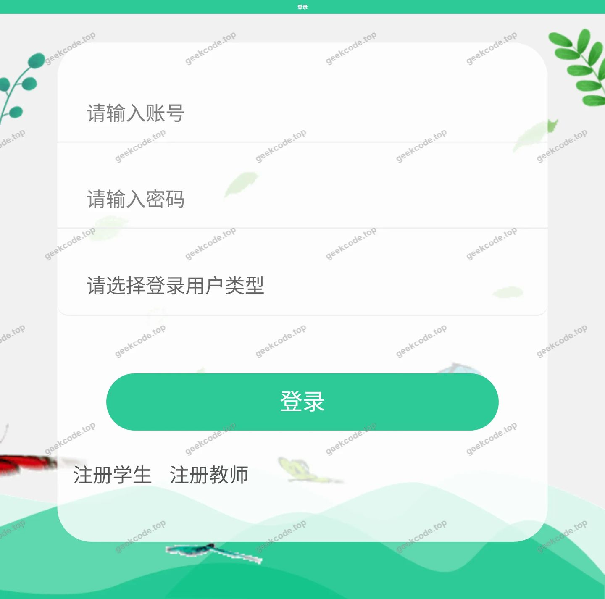</a>

<h3>微信小程序用户端</h3>

<figure><figcaption>小程序-毕业论文列表</figcaption></figure>
<figure><a href="https://geekcode.top/archives/%E5%AD%A6%E7%94%9F%E6%AF%95%E4%B8%9A%E7%AE%A1%E7%90%86%E7%B3%BB%E7%BB%9Fy65fk-%E8%AE%BA%E6%96%87?utm_source=github" title="查看完整源码">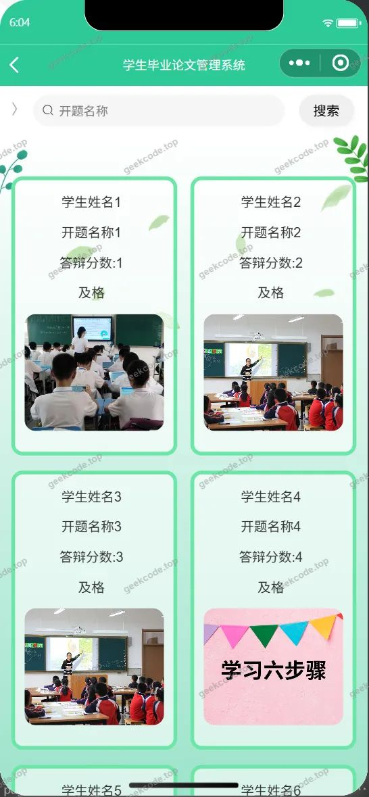</a><figcaption>小程序-答辩评审列表</figcaption></figure>
<figure><a href="https://geekcode.top/archives/%E5%AD%A6%E7%94%9F%E6%AF%95%E4%B8%9A%E7%AE%A1%E7%90%86%E7%B3%BB%E7%BB%9Fy65fk-%E8%AE%BA%E6%96%87?utm_source=github" title="查看完整源码">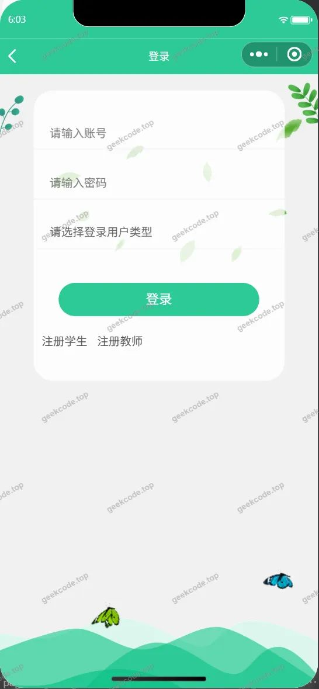</a><figcaption>小程序-登录</figcaption></figure>
<figure><a href="https://geekcode.top/archives/%E5%AD%A6%E7%94%9F%E6%AF%95%E4%B8%9A%E7%AE%A1%E7%90%86%E7%B3%BB%E7%BB%9Fy65fk-%E8%AE%BA%E6%96%87?utm_source=github" title="查看完整源码">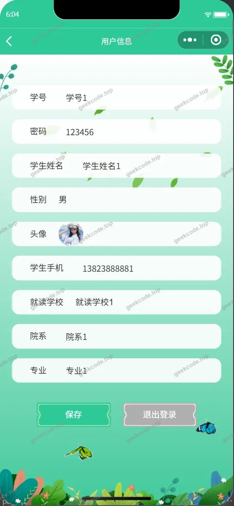</a><figcaption>小程序-个人信息</figcaption></figure>
<figure><figcaption>小程序-教师</figcaption></figure>
<figure><a href="https://geekcode.top/archives/%E5%AD%A6%E7%94%9F%E6%AF%95%E4%B8%9A%E7%AE%A1%E7%90%86%E7%B3%BB%E7%BB%9Fy65fk-%E8%AE%BA%E6%96%87?utm_source=github" title="查看完整源码">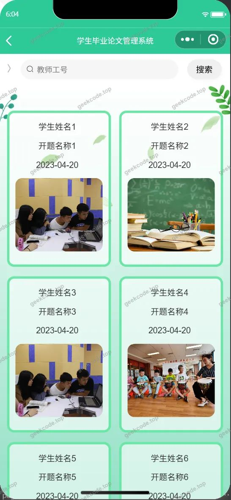</a><figcaption>小程序-开题答辩列表</figcaption></figure>
<figure><figcaption>小程序-师生双选列表</figcaption></figure>
<figure><figcaption>小程序-首页</figcaption></figure>
<figure><a href="https://geekcode.top/archives/%E5%AD%A6%E7%94%9F%E6%AF%95%E4%B8%9A%E7%AE%A1%E7%90%86%E7%B3%BB%E7%BB%9Fy65fk-%E8%AE%BA%E6%96%87?utm_source=github" title="查看完整源码">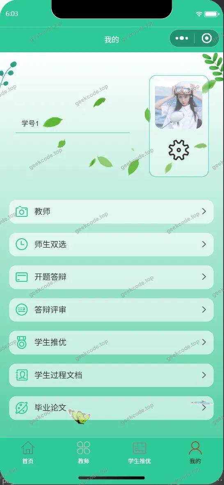</a><figcaption>小程序-我的</figcaption></figure>
<figure><a href="https://geekcode.top/archives/%E5%AD%A6%E7%94%9F%E6%AF%95%E4%B8%9A%E7%AE%A1%E7%90%86%E7%B3%BB%E7%BB%9Fy65fk-%E8%AE%BA%E6%96%87?utm_source=github" title="查看完整源码">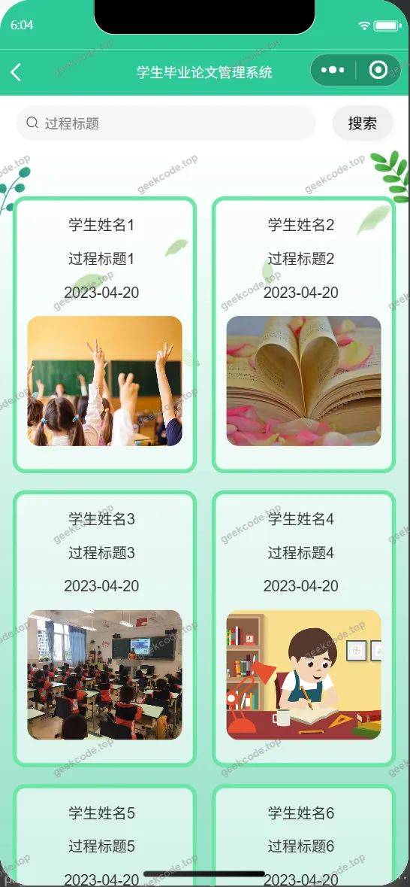</a><figcaption>小程序-学生过程文档列表</figcaption></figure>
<figure><a href="https://geekcode.top/archives/%E5%AD%A6%E7%94%9F%E6%AF%95%E4%B8%9A%E7%AE%A1%E7%90%86%E7%B3%BB%E7%BB%9Fy65fk-%E8%AE%BA%E6%96%87?utm_source=github" title="查看完整源码">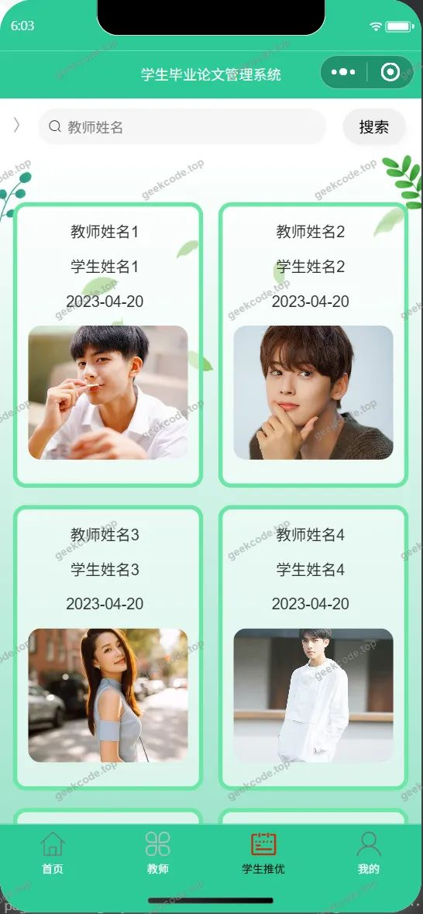</a><figcaption>小程序-学生推优</figcaption></figure>
<figure><a href="https://geekcode.top/archives/%E5%AD%A6%E7%94%9F%E6%AF%95%E4%B8%9A%E7%AE%A1%E7%90%86%E7%B3%BB%E7%BB%9Fy65fk-%E8%AE%BA%E6%96%87?utm_source=github" title="查看完整源码">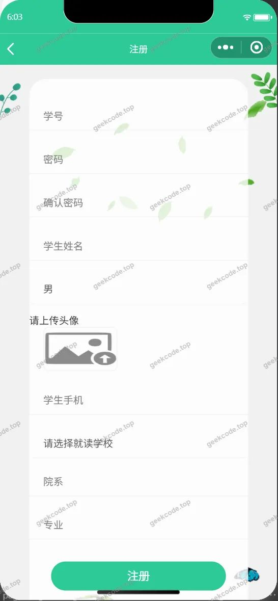</a><figcaption>小程序-注册</figcaption></figure>

<h3>微信小程序管理端</h3>

<figure><figcaption>小程序-管理端-公告信息列表</figcaption></figure>
<figure><figcaption>小程序-管理端-关于我们列表</figcaption></figure>
<figure><a href="https://geekcode.top/archives/%E5%AD%A6%E7%94%9F%E6%AF%95%E4%B8%9A%E7%AE%A1%E7%90%86%E7%B3%BB%E7%BB%9Fy65fk-%E8%AE%BA%E6%96%87?utm_source=github" title="查看完整源码">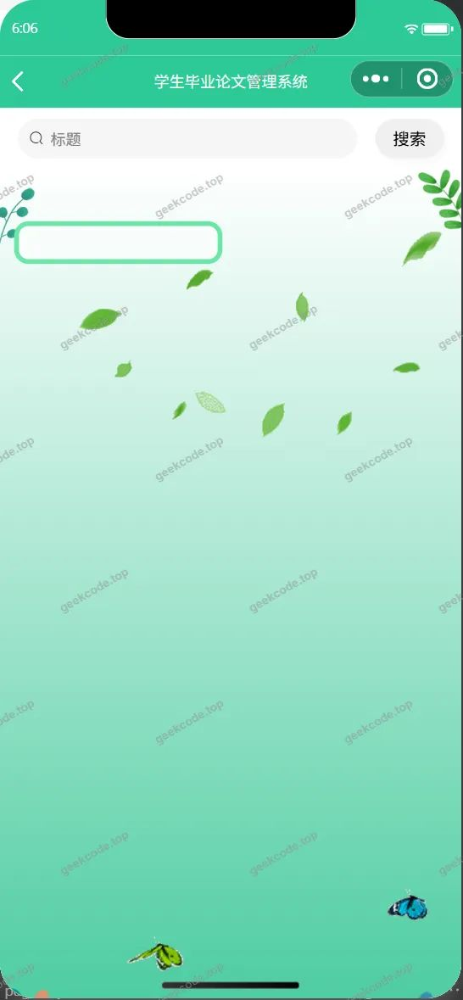</a><figcaption>小程序-管理端-系统简介列表</figcaption></figure>
<figure><figcaption>小程序-管理端-学生列表</figcaption></figure>
<figure><a href="https://geekcode.top/archives/%E5%AD%A6%E7%94%9F%E6%AF%95%E4%B8%9A%E7%AE%A1%E7%90%86%E7%B3%BB%E7%BB%9Fy65fk-%E8%AE%BA%E6%96%87?utm_source=github" title="查看完整源码">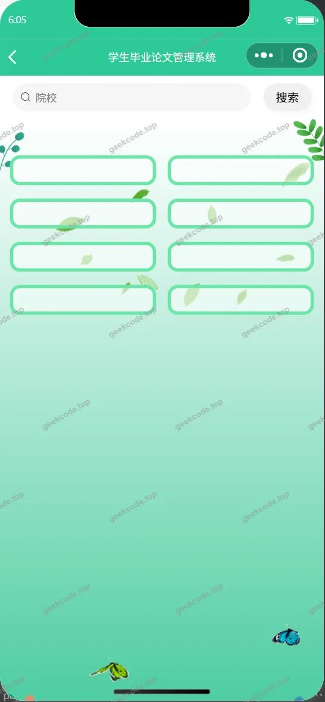</a><figcaption>小程序-管理端-院校列表</figcaption></figure>

<h3>微信小程序教师端</h3>
<h4>小程序-教师-教师过程文档列表</h4>

<a href="https://geekcode.top/archives/%E5%AD%A6%E7%94%9F%E6%AF%95%E4%B8%9A%E7%AE%A1%E7%90%86%E7%B3%BB%E7%BB%9Fy65fk-%E8%AE%BA%E6%96%87?utm_source=github" title="查看完整源码">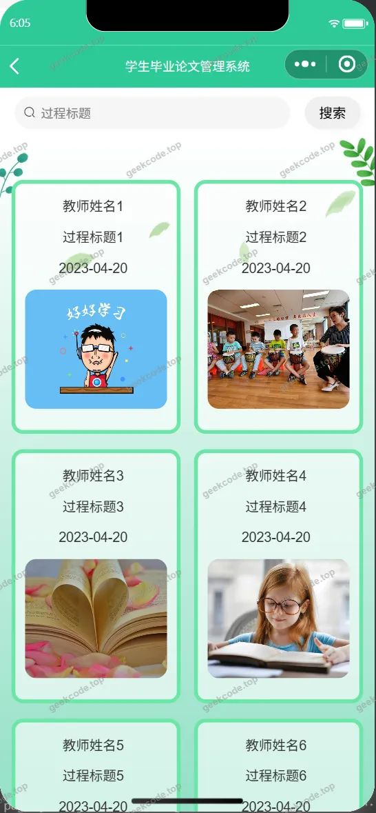</a>

<h3>后台管理端</h3>
<h4>后台-登录页</h4>

<h4>后台-公告信息</h4>

<a href="https://geekcode.top/archives/%E5%AD%A6%E7%94%9F%E6%AF%95%E4%B8%9A%E7%AE%A1%E7%90%86%E7%B3%BB%E7%BB%9Fy65fk-%E8%AE%BA%E6%96%87?utm_source=github" title="查看完整源码">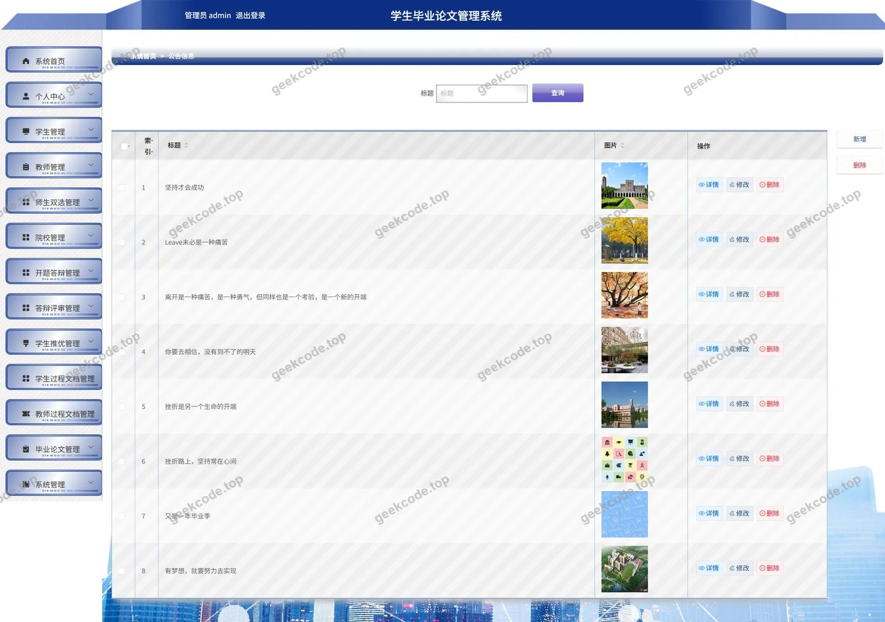</a>

<h4>后台-关于我们</h4>

<a href="https://geekcode.top/archives/%E5%AD%A6%E7%94%9F%E6%AF%95%E4%B8%9A%E7%AE%A1%E7%90%86%E7%B3%BB%E7%BB%9Fy65fk-%E8%AE%BA%E6%96%87?utm_source=github" title="查看完整源码">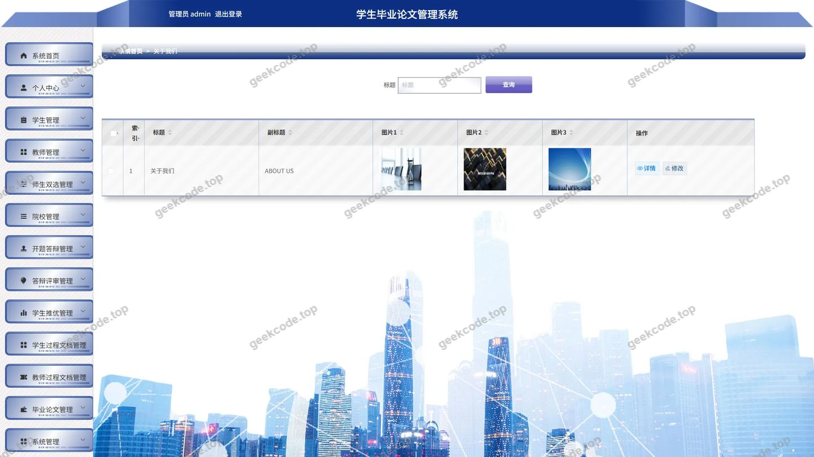</a>

<h4>后台-教师过程文档</h4>

<a href="https://geekcode.top/archives/%E5%AD%A6%E7%94%9F%E6%AF%95%E4%B8%9A%E7%AE%A1%E7%90%86%E7%B3%BB%E7%BB%9Fy65fk-%E8%AE%BA%E6%96%87?utm_source=github" title="查看完整源码">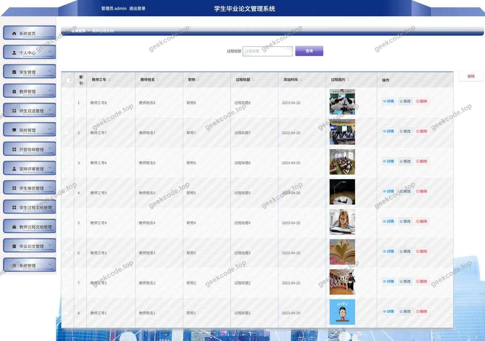</a>

<h4>后台-师生双选</h4>

<h4>后台首页</h4>

<a href="https://geekcode.top/archives/%E5%AD%A6%E7%94%9F%E6%AF%95%E4%B8%9A%E7%AE%A1%E7%90%86%E7%B3%BB%E7%BB%9Fy65fk-%E8%AE%BA%E6%96%87?utm_source=github" title="查看完整源码">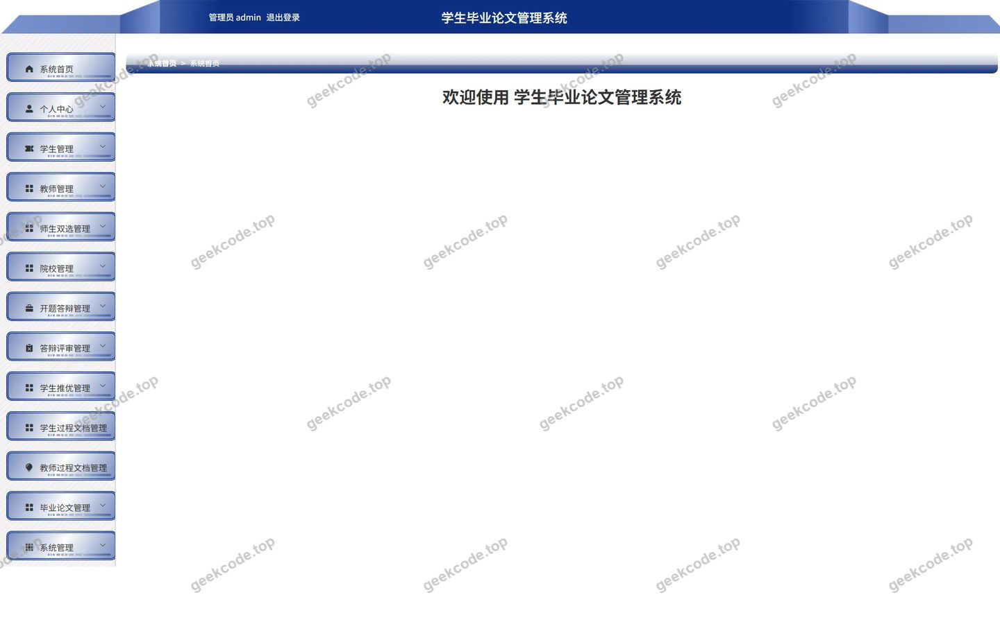</a>

<h4>后台-学生</h4>

<a href="https://geekcode.top/archives/%E5%AD%A6%E7%94%9F%E6%AF%95%E4%B8%9A%E7%AE%A1%E7%90%86%E7%B3%BB%E7%BB%9Fy65fk-%E8%AE%BA%E6%96%87?utm_source=github" title="查看完整源码">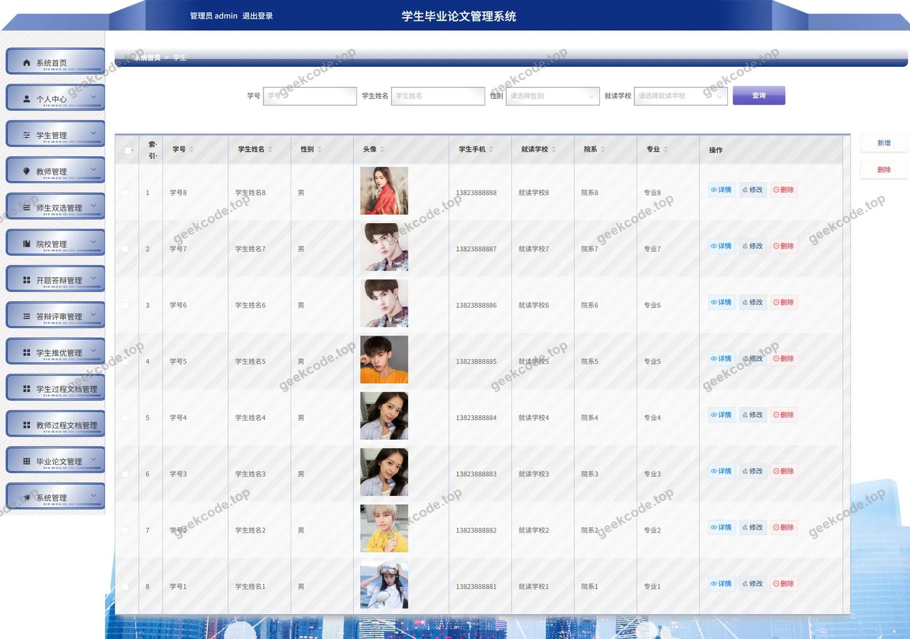</a>

<h4>后台-学生推优</h4>

<a href="https://geekcode.top/archives/%E5%AD%A6%E7%94%9F%E6%AF%95%E4%B8%9A%E7%AE%A1%E7%90%86%E7%B3%BB%E7%BB%9Fy65fk-%E8%AE%BA%E6%96%87?utm_source=github" title="查看完整源码">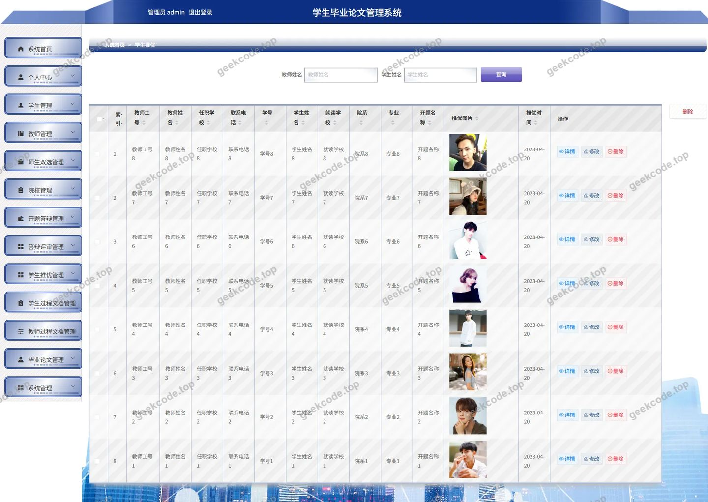</a>

---

## 获取完整源码

| 项目 | 说明 |
| --- | --- |
| 项目名 | 学生毕业管理系统y65fk--论文 |
| 运行截图 | 本文 27 张（站点带水印原图，仓库 `images/` 目录） |
| 完整源码 | [https://geekcode.top/archives/%E5%AD%A6%E7%94%9F%E6%AF%95%E4%B8%9A%E7%AE%A1%E7%90%86%E7%B3%BB%E7%BB%9Fy65fk-%E8%AE%BA%E6%96%87?utm_source=github](https://geekcode.top/archives/%E5%AD%A6%E7%94%9F%E6%AF%95%E4%B8%9A%E7%AE%A1%E7%90%86%E7%B3%BB%E7%BB%9Fy65fk-%E8%AE%BA%E6%96%87?utm_source=github) |
| 咨询微信 | **ir9372**（备注：jingpin-yuanma） |
| 更多项目 | [极客代码 geekcode.top](https://geekcode.top/?utm_source=github) |

> 需要源码、部署、改配置、跑不起来等问题，加微信 ir9372 沟通，说明项目名即可。
